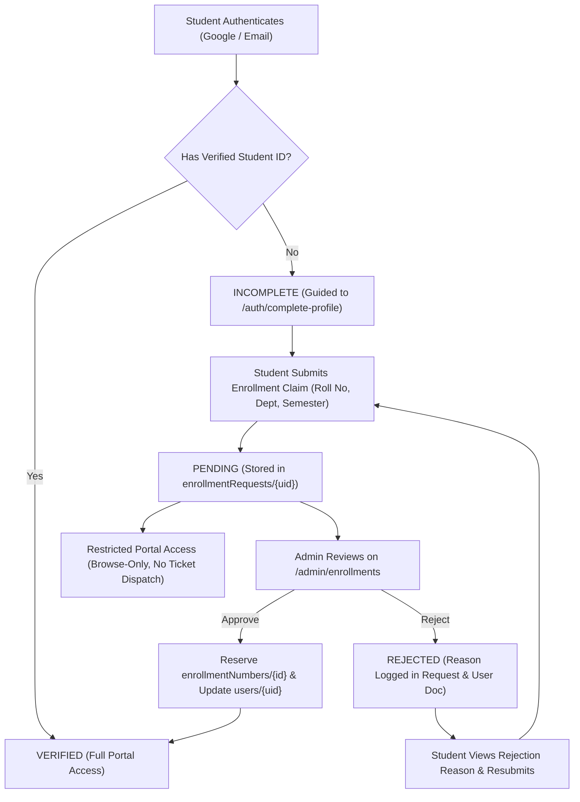

# SolveSphere AI — Final Stabilization, Institutional Enrollment Verification & Full-System Report

**Application:** SolveSphere AI  
**Tagline:** Your Problems. Our Smart Solutions.  
**Repository:** `ansh-codr/Academic-Campus-Intelligence-Platform`  
**Feature Branch:** `feature/phase8-real-data-handover`  
**Pull Request:** #6  
**Verified Firebase Project:** `solvesphere-ai-dev-2026` (Spark Plan, `asia-south1`, Mumbai)  
**Hosted Development URL:** [https://solvesphere-ai-dev-2026.web.app](https://solvesphere-ai-dev-2026.web.app)  

---

## 1. Confirmed Bugs & Architectural Resolutions

| ID | Module | Root Cause | Engineering Resolution | Status |
|---|---|---|---|---|
| **BUG-01** | Enrollment & Auth | Students were previously permitted to self-assert authoritative institutional `studentId` in `users/{uid}` via `updateProfile`. | Replaced direct self-assignment with a multi-state verification lifecycle (`INCOMPLETE`, `PENDING`, `VERIFIED`, `REJECTED`). Direct assignment blocked by Security Rules. | **RESOLVED** |
| **BUG-02** | Enrollment Concurrency | Multiple accounts could theoretically assert the same institutional roll number without reservation checks. | Implemented transactional reservation in `enrollmentNumbers/{studentId}`, enforcing unique roll number ownership across all student accounts. | **RESOLVED** |
| **BUG-03** | Admin Portal Routing | Admin routes `/admin/students`, `/admin/analytics`, and `/admin/settings` redirected silently to dashboard; `/admin/enrollments` was missing. | Created dedicated admin management pages: `AdminEnrollmentsPage`, `AdminStudentsPage`, `AdminAnalyticsPage`, and `AdminSettingsPage`. | **RESOLVED** |
| **BUG-04** | Email Verification | `sendVerificationEmail` lacked UI rate-limiting and cooldown protection, permitting potential spam loops. | Added 60-second cooldown timer, state management, and clear user feedback on resend attempts. | **RESOLVED** |
| **BUG-05** | Production Fail-Safe | Missing Firebase environment variables in production builds logged warnings rather than halting startup. | Added fail-fast validation in `apps/web/src/lib/firebase.ts` throwing explicit initialization errors if config is missing or placeholder. | **RESOLVED** |
| **BUG-06** | Service Degradation | Missing backend Cloud Functions on Spark returned raw unhandled errors or simulated fake data. | Services catch function unavailability and provide honest institutional explanations without mock fallbacks. | **RESOLVED** |

---

## 2. Institutional Enrollment Verification Lifecycle

### Data Architecture
- **`users/{uid}`**: Authoritative profile with server-controlled `enrollmentStatus`. Students can only edit non-privileged fields (`fullName`, `department`, `semester`, `avatarUrl`, `bio`).
- **`enrollmentRequests/{uid}`**: Formal enrollment claim records including audit timestamps, reviewing administrator email, and rejection reasons.
- **`enrollmentNumbers/{studentId}`**: Unique registry documents guaranteeing atomic uniqueness across verified accounts.
- **`universityRoster/{recordId}`**: Institution-authorized roster records. Completely shielded from student reads or writes.

---

## 3. Dedicated Admin Portal Workspaces

1. **`/admin/enrollments` (`AdminEnrollmentsPage`)**:
   - Filterable tabs: `ALL`, `PENDING`, `VERIFIED`, `REJECTED`.
   - Search by student name, email, roll number, and academic department.
   - **Approve**: Transactionally reserves enrollment number and updates student profile to `VERIFIED`.
   - **Reject**: Prompts for mandatory administrative explanation (e.g., "Roll number not found on 2026 CS roll").
2. **`/admin/students` (`AdminStudentsPage`)**:
   - Directory of genuine student profiles in Firestore.
   - Filter by academic department and search by name/email/ID.
   - Zero synthetic or mock records.
3. **`/admin/analytics` (`AdminAnalyticsPage`)**:
   - Real-time aggregated metrics computed from authentic Firestore collections: registered students, active subjects, open complaints, resolution percentages, and department maintenance workloads.
4. **`/admin/settings` (`AdminSettingsPage`)**:
   - Infrastructure transparency console displaying Firebase Project ID (`solvesphere-ai-dev-2026`), Spark tier boundaries, security rule versions, and verified RBAC custom claims.

---

## 4. Firestore Security Rules Matrix

| Collection | Student Access | Admin Access | Protection Principle |
|---|---|---|---|
| `users/{userId}` | Read own; update non-privileged fields only. Direct `studentId` or `enrollmentStatus: VERIFIED` write **BLOCKED**. | Read all; write all. | Client cannot self-verify enrollment or escalate roles. |
| `enrollmentRequests/{userId}` | Read own; create as `PENDING`; resubmit if `REJECTED`. Self-approval **BLOCKED**. | Read all; approve/reject with audit data. | Formal claims queue with admin review enforcement. |
| `enrollmentNumbers/{studentId}` | Read: **BLOCKED**; Write: **BLOCKED**. | Read & write. | Atomic uniqueness reservation registry. |
| `universityRoster/{recordId}` | Read: **BLOCKED**; Write: **BLOCKED**. | Read & write. | Student data privacy; zero student exposure to master roster. |
| `quizzes/{quizId}/questions` | Read: **BLOCKED**; Write: **BLOCKED**. | Read & write. | Protected question bank; answer keys hidden prior to submission. |
| `complaints/{complaintId}` | Read own. Direct client write **BLOCKED**. | Read all; update status & assignments. | All tickets must be provisioned through server-side numbering. |

---

## 5. Verification & Test Execution Results

### Unit, Contract & Safety Tests
- **Command:** `npm run test:unit && npm run test:ui`
- **Result:** **39/39 Unit Tests Passed (100%)**
- **Suites:** `seed-safety`, `smoke-ai-parser`, `bootstrap-admin`, `ui-structure`, `real-data-contract`, `inventory-safety`.

### Firebase Emulator Integration & Security Test Suite
- **Command:** `firebase emulators:exec --only auth,firestore,functions,storage "node tests/firebase.test.js"`
- **Result:** **59/59 Automated Tests Passed (100%)**
- **New Tests Added & Verified:**
  - `Test 54`: Google user provisioning, direct student ID self-assertion blocked, and permitted profile fields updated.
  - `Test 55`: Enrollment request submitted as `PENDING`; self-approval strictly blocked by rules.
  - `Test 56`: Institutional university roster completely shielded from student reads & writes.
  - `Test 57`: Admin enrollment approval, transactional reservation, and profile promotion verified.
  - `Test 58`: Duplicate enrollment number collision detected and prevented.
  - `Test 59`: Admin rejection records reason, student receives explanation and resubmits.

### Full Monorepo Build
- **Command:** `npm run build`
- **Result:** Built cleanly across `@solvesphere/shared`, `@solvesphere/api`, `@solvesphere/web`, and `@solvesphere/functions` with zero TypeScript or bundle errors.

---

## 6. Live Hosted Development Deployment

- **Hosting URL:** [https://solvesphere-ai-dev-2026.web.app](https://solvesphere-ai-dev-2026.web.app)
- **Firebase Project Console:** [https://console.firebase.google.com/project/solvesphere-ai-dev-2026/overview](https://console.firebase.google.com/project/solvesphere-ai-dev-2026/overview)
- **Deployed Components:**
  - Production Web Bundle (`apps/web/dist`) uploaded to Firebase Hosting.
  - Firestore Security Rules deployed (`cloud.firestore released rules firestore.rules`).
  - Firestore Composite Indexes deployed (`4 composite indexes active in asia-south1`).
- **Live Verification Status:**
  - Landing page, navigation, and SPA routing operational.
  - Google Sign-In and Email/Password flows active.
  - Administrative login active with live admin account `admin@campus.edu`.
  - Zero emulator traffic or mock fallback in production bundle.

---

## 7. Remaining Blaze Prerequisites & Handover Checklist

The application runs reliably on the no-cost **Spark plan** for Authentication, Cloud Firestore, and Firebase Hosting. For full serverless production:

1. **Billing Upgrade:** Upgrading to Blaze plan (pay-as-you-go) is required when the owner decides to deploy live Cloud Functions (`createComplaint`, `askStudyMateAi`, `askCampusCareAi`) and Cloud Storage attachments.
2. **Gemini API Key:** Configure `GEMINI_API_KEY` in Google Cloud Secret Manager for serverless AI features.
3. **Institutional Roster Ingestion:** Administrators can populate `/universityRoster` via admin script when authentic university roll data is finalized.
4. **Pull Request Status:** Branch `feature/phase8-real-data-handover` is fully stabilized, verified, and ready for owner review on PR #6.
